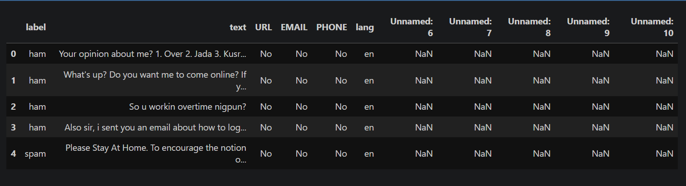
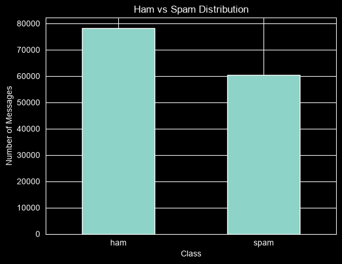
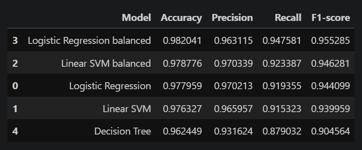
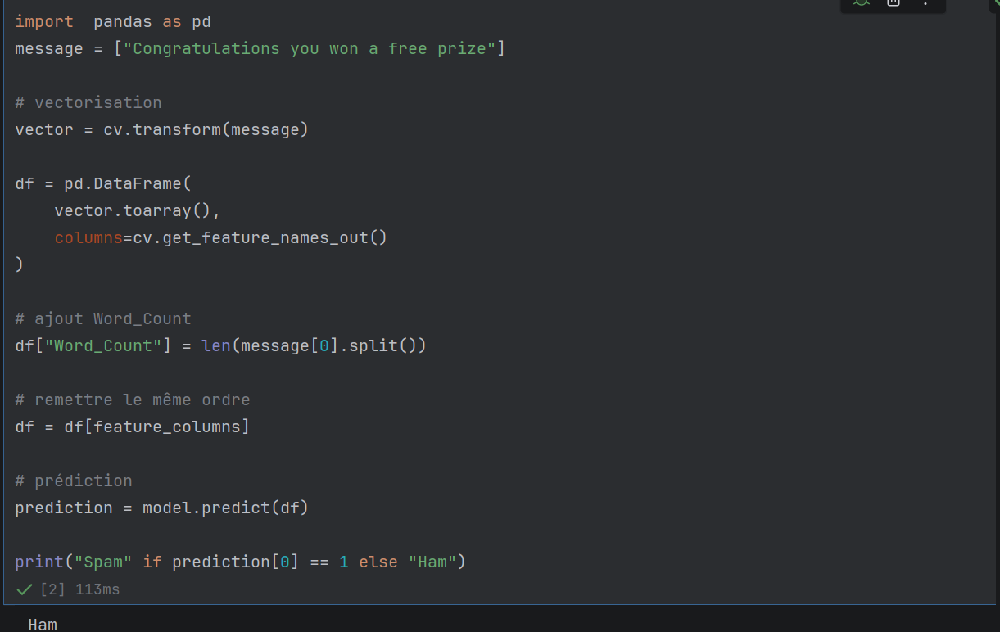

# SMS Spam Detection Using Machine Learning

A Natural Language Processing (NLP) project that classifies SMS messages as spam or legitimate using text preprocessing, feature engineering, and supervised machine learning. The project compares multiple classification algorithms and evaluates their performance using accuracy, precision, recall, and F1-score.


---

## Table of Contents

- [Overview](#overview)
- [Objectives](#objectives)
- [Dataset](#dataset)
- [Data Preprocessing](#data-preprocessing)
- [Feature Engineering](#feature-engineering)
- [NLP Pipeline](#nlp-pipeline)
- [Machine Learning Models](#machine-learning-models)
- [Model Evaluation](#model-evaluation)
- [Best Performing Model](#best-performing-model)
- [Prediction Examples](#prediction-examples)
- [Screenshots](#screenshots)
- [Model Persistence](#model-persistence)
- [Technology Stack](#technology-stack)
- [Project Structure](#project-structure)
- [Installation and Setup](#installation-and-setup)
- [Usage](#usage)
- [Future Improvements](#future-improvements)
- [Author](#author)

---

## Overview

SMS Spam Detection is a machine learning project designed to automatically classify text messages into two categories:

- **Spam (1):** Unwanted, unsolicited, or potentially fraudulent messages.
- **Ham (0):** Legitimate messages.

The project implements an end-to-end text classification workflow, from data preparation and feature extraction to model training, evaluation, and prediction on new messages.

Several machine learning algorithms are compared to identify a model that provides a strong balance between detecting spam and minimizing incorrect classifications.

The project explores an important practical application of Natural Language Processing: identifying unwanted messages through patterns in text data.

---

## Objectives

The main objectives of this project are to:

- Build an automated SMS spam classification system.
- Apply Natural Language Processing techniques to unstructured text.
- Transform text messages into numerical features suitable for machine learning.
- Engineer additional features from message content.
- Compare multiple supervised classification algorithms.
- Investigate the effect of class imbalance on model performance.
- Evaluate models using multiple classification metrics.
- Select and save a suitable model for future predictions.

---

## Dataset

The dataset contains SMS messages labeled as either spam or legitimate.

### Target Variable

| Label | Category | Description |
|---|---|---|
| 0 | Ham | Legitimate SMS message |
| 1 | Spam | Unwanted or potentially fraudulent SMS message |

### Data Features

The dataset and preprocessing workflow include message text and information derived from message content.

Depending on the available columns, these features include:

- SMS message text.
- Word count.
- URL detection.
- Email address detection.
- Phone number detection.
- Numeric content detection.
- Language information, where available.

These features help the model identify patterns associated with spam messages.

### Dataset Preparation

The data preparation process includes inspecting the dataset, examining the target distribution, identifying unnecessary columns, handling missing values, and preparing the target labels for classification.

---

## Data Preprocessing

Text preprocessing is an important step because SMS messages often contain inconsistent formatting, abbreviations, URLs, phone numbers, and other elements that may influence classification.

### Data Cleaning

The preprocessing workflow includes:

- Removing unnecessary columns.
- Handling missing values.
- Converting text to lowercase.
- Cleaning text using regular expressions.
- Normalizing selected patterns in messages.
- Encoding the target labels.
- Preparing the text for tokenization and vectorization.

### Text Normalization

Selected patterns are replaced with standardized tokens to reduce variations in the input data.

| Original Content | Replacement Token |
|---|---|
| Email addresses | `emailaddr` |
| URLs | `httpaddr` |
| Monetary symbols | `moneysymb` |
| Phone numbers | `phonenumbr` |
| Numeric sequences | `numbr` |

These replacements help the classifier learn patterns associated with different types of message content without depending on every individual URL, phone number, or email address.

---

## Feature Engineering

In addition to text-based features, the project uses information extracted from SMS messages.

### Engineered Features

- **Word Count:** Measures the number of words in a message.
- **URL Detection:** Identifies messages containing URLs.
- **Email Detection:** Identifies email addresses in message content.
- **Phone Number Detection:** Identifies phone-number patterns.
- **Number Detection:** Identifies numeric content.

### Text Vectorization

The project uses `CountVectorizer` from Scikit-Learn to convert processed text into numerical feature vectors.

The vocabulary is limited to 3,000 text features, with `Word_Count` added as an additional feature.

The resulting feature representation combines text-based information with a numerical characteristic of each message.

```python
CountVectorizer(max_features=3000)
```

The exact preprocessing and feature construction steps should remain consistent between training and inference.

---

## NLP Pipeline

The text classification workflow follows these steps:

```text
                 Raw SMS Messages
                        |
                        v
                 Data Inspection
                        |
                        v
                  Data Cleaning
                        |
                        v
                Lowercase Conversion
                        |
                        v
                 Regex Processing
                        |
                        v
                    Tokenization
                        |
                        v
                 Stopword Removal
                        |
                        v
                  Porter Stemming
                        |
                        v
                 CountVectorizer
                        |
                        v
              Numerical Feature Matrix
                        |
                        v
                 Model Training
                        |
                        v
                 Model Evaluation
                        |
                        v
               Spam / Ham Prediction
```

The preprocessing pipeline prepares the text for feature extraction, while the trained classifier learns patterns that distinguish spam messages from legitimate ones.

---

## Machine Learning Models

Five model configurations were evaluated to compare their classification performance.

### Models Evaluated

1. Logistic Regression with class balancing.
2. Linear Support Vector Machine with class balancing.
3. Standard Logistic Regression.
4. Standard Linear Support Vector Machine.
5. Decision Tree Classifier.

### Feature Representation

The models use text features extracted with `CountVectorizer`, combined with the additional `Word_Count` feature.

### Handling Class Imbalance

The project evaluates class-balanced configurations of Logistic Regression and Linear SVM.

Class weighting assigns greater importance to the minority class during training, which can improve the detection of spam messages when legitimate messages significantly outnumber spam messages.

The effectiveness of class balancing is assessed using precision, recall, and F1-score rather than accuracy alone.

---

## Model Evaluation

The models are compared using four standard classification metrics.

| Metric | Description |
|---|---|
| Accuracy | Proportion of all predictions that are correct. |
| Precision | Proportion of predicted spam messages that are actually spam. |
| Recall | Proportion of actual spam messages correctly identified. |
| F1-score | Harmonic mean of precision and recall. |

Precision and recall are particularly important for spam detection because false positives can cause legitimate messages to be incorrectly classified as spam, while false negatives allow unwanted messages to pass through the filter.

### Model Comparison Results

The following table summarizes the reported evaluation results.

| Model | Accuracy | Precision | Recall | F1-score |
|---|---:|---:|---:|---:|
| Logistic Regression (Balanced) | **98.20%** | 96.31% | **94.76%** | **95.53%** |
| Linear SVM (Balanced) | 97.88% | **97.03%** | 92.34% | 94.63% |
| Logistic Regression | 97.80% | 97.02% | 91.94% | 94.41% |
| Linear SVM | 97.63% | 96.60% | 91.53% | 93.99% |
| Decision Tree | 95.92% | 91.25% | 88.31% | 89.75% |

*Results are based on the project's reported evaluation. Performance may vary depending on the dataset, preprocessing configuration, train-test split, and evaluation methodology.*

---

## Best Performing Model

The selected model is Logistic Regression with class balancing.

```python
LogisticRegression(class_weight="balanced")
```

### Reported Performance

| Metric | Score |
|---|---:|
| Accuracy | 98.20% |
| Spam Precision | 96.31% |
| Spam Recall | 94.76% |
| Spam F1-score | 95.53% |

### Why Logistic Regression with Class Balancing?

The selected configuration achieved the highest reported accuracy, recall, and F1-score among the evaluated models.

Class balancing helps account for differences in class frequency during training, improving the model's ability to identify spam messages without relying solely on the majority class.

The Linear SVM with class balancing achieved slightly higher precision, making it another useful configuration when reducing false-positive spam predictions is a priority.

The final model selection therefore considers multiple evaluation metrics rather than accuracy alone.

---

## Prediction Examples

The trained classifier can be used to predict the category of a new SMS message after applying the same preprocessing and feature extraction steps used during training.

### Example 1: Spam Message

**Input:**

```text
Congratulations! You won a free prize. Call now!
```

**Expected classification:**

```text
Spam
```

### Example 2: Legitimate Message

**Input:**

```text
Hey, are we meeting tomorrow?
```

**Expected classification:**

```text
Ham
```

These examples illustrate the intended behavior of the classifier. Actual predictions depend on the trained model and its preprocessing pipeline.

---

## Screenshots

The following screenshots illustrate selected stages of the project, from data exploration to model evaluation and prediction.

### 1. Dataset Overview

Preview of the dataset after loading and initial inspection.



### 2. Class Distribution

Distribution of SMS messages across the Spam and Ham categories.



### 3. Model Comparison

Comparison of the evaluated machine learning models using accuracy, precision, recall, and F1-score.



### 4. Spam Prediction Example

Example of a prediction performed by the trained classifier.



---

## Model Persistence

The trained model components are saved using `joblib` so that they can be loaded for future predictions without retraining the classifier.

### Saved Components

```text
models/
├── spam_model.pkl
├── count_vectorizer.pkl
└── features_columns.pkl
```

| File | Purpose |
|---|---|
| `spam_model.pkl` | Stores the trained classification model. |
| `count_vectorizer.pkl` | Stores the fitted text vectorizer and its vocabulary. |
| `features_columns.pkl` | Stores the expected feature names or ordering, as implemented in the project. |

### Benefits

- Reuse the trained classifier.
- Avoid retraining for every prediction.
- Preserve the fitted text vocabulary.
- Maintain consistency between training and inference.

The model, vectorizer, and feature construction logic must remain compatible when generating predictions.

**Security note:** Only load serialized model files from trusted sources. Pickle-based formats, including files saved through `joblib`, can execute arbitrary code when loaded.

---

## Technology Stack

### Programming Language

- Python 3.10+

### Data Analysis

- Pandas
- NumPy

### Machine Learning

- Scikit-Learn
- Logistic Regression
- Linear Support Vector Machine
- Decision Tree Classifier

### Natural Language Processing

- NLTK
- Regular Expressions
- Tokenization
- Stopword Removal
- Porter Stemming

### Text Feature Extraction

- CountVectorizer

### Model Persistence

- Joblib

### Development Tools

- Jupyter Notebook
- Visual Studio Code
- PyCharm
- Git
- GitHub

---

## Project Structure

The repository is organized to separate the dataset, notebooks, saved models, and visual assets.

```text
SMS-Spam-Detection/
│
├── dataset/
│   └── sms_dataset.csv
│
├── notebooks/
│   └── spam_detection.ipynb
│
├── models/
│   ├── spam_model.pkl
│   ├── count_vectorizer.pkl
│   └── features_columns.pkl
│
├── images/
│   ├── dataset_preview.png
│   ├── class_distribution.png
│   ├── model_comparison.png
│   └── prediction_example.png
│
├── requirements.txt
│
└── README.md
```

The directory structure may vary depending on the actual contents of the repository.

---

## Installation and Setup

### Prerequisites

Make sure you have installed:

- Python 3.10 or a compatible version.
- pip.
- Git.
- Jupyter Notebook or JupyterLab.

### 1. Clone the Repository

Replace `<repository-name>` with the actual GitHub repository name.

```bash
git clone https://github.com/Belak17/<repository-name>.git
cd <repository-name>
```

### 2. Create a Virtual Environment

Creating a virtual environment helps isolate project dependencies.

**Windows:**

```powershell
python -m venv .venv
.venv\Scripts\Activate.ps1
```

**Linux or macOS:**

```bash
python3 -m venv .venv
source .venv/bin/activate
```

### 3. Install Dependencies

Install the required packages:

```bash
pip install -r requirements.txt
```

If the repository does not include a `requirements.txt` file, install the dependencies used by the notebook.

For example:

```bash
pip install pandas numpy scikit-learn nltk jupyter joblib matplotlib seaborn
```

Only packages actually required by the project need to be installed.

### 4. Launch Jupyter Notebook

Run:

```bash
jupyter notebook
```

Open the notebook located in the `notebooks/` directory.

---

## Usage

To reproduce the machine learning workflow:

1. Load the SMS dataset.
2. Inspect the data and target distribution.
3. Clean and preprocess the messages.
4. Extract text features using `CountVectorizer`.
5. Combine the text representation with the additional numerical features.
6. Split the data into training and testing sets.
7. Train the candidate classification models.
8. Evaluate the models using accuracy, precision, recall, and F1-score.
9. Select the preferred model.
10. Save the trained model and its associated preprocessing components.
11. Use the saved components to classify new messages.

Execute the notebook cells in the appropriate order to reproduce the results.

---

## Future Improvements

Potential enhancements include:

- TF-IDF vectorization to explore alternative text representations.
- Word embeddings using Word2Vec or GloVe.
- Transformer-based models such as BERT.
- Hyperparameter optimization.
- Cross-validation for more robust model evaluation.
- Confusion matrix visualization.
- Precision-recall curve analysis.
- A FastAPI REST API for serving predictions.
- A Streamlit interface for interactive classification.
- Docker-based deployment.
- Expanded testing of the preprocessing and prediction pipeline.

These improvements could help assess generalization, improve usability, and make the classifier easier to integrate into other applications.

---

## Author

### Kaleb AKAKPO

Software Engineering Student | Backend Development & Machine Learning

Interested in backend engineering, data analysis, and machine learning applications.

- GitHub: [Belak17](https://github.com/Belak17)

---

If you find this project interesting, consider giving the repository a star on GitHub.
